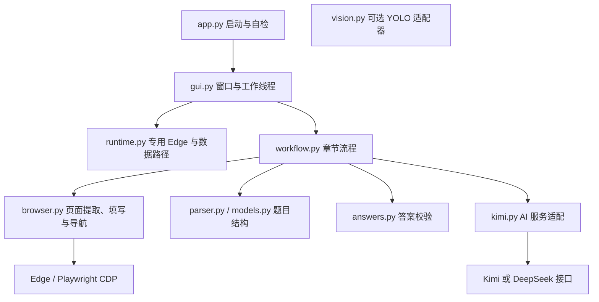

# 项目现状与团队分工

核查对象：当前工作区源码，版本 `1.1.3`。本文描述代码已实现的行为，在线服务、真实课程页面和已打包 EXE 的行为需各自验证。

## 项目定位与当前能力

这是一个面向 Windows / Microsoft Edge 的 Python 桌面程序。用户在软件专用 Edge 中自行登录并进入课程小节后，程序读取学习通章节目录，寻找章节测验，调用所选 AI 服务，校验答案，再按运行模式填写或提交。它适合继续作为软件工程课程项目实践分层设计、浏览器自动化、接口适配、自动化测试和发布管理。

当前源码已经实现：

- PySide6 桌面界面，提供浏览器启动、连接检查、当前章节解析、测试模式、真实提交模式、停止、错误指引和日志。
- Playwright 通过本机 CDP 连接专用 Edge，识别目录完成状态、切换未完成小节、查找测验标签，并在常规入口失效时扫描同排任务标签。
- 动态提取题数和题型，支持单选、多选、判断；对题号、题量、题型数量、选项范围和答案完整性进行校验。
- 对使用加密字体的页面逐题截图，通过图片消息交给 AI；截图消息构造与真实服务能否接收该消息是两项不同的验收。
- `KimiSolver` 与 `DeepSeekSolver` 共用 AI 适配基类，支持 JSON 解析、无效答案单题重试、429 退避。源码当前默认模型分别为 `kimi-k2.6` 和 `deepseek-flash`；账号权限和在线可用性仍须以服务端实际响应验证。
- 完整答案门槛、填写后复核、提交确认弹窗和结果状态检查；默认测试模式会填写、复核并继续导航，不点击真实提交。
- 按章节记录统计结果；正常结束可在 5 秒后退出桌面程序；异常与手动停止保留窗口。
- PyInstaller 打包配置和发布 ZIP 校验脚本，检查入口文件、浏览器驱动，以及禁止把浏览器配置和日志装入发布包。

## 模块关系



| 模块 | 责任与维护边界 |
| --- | --- |
| `app.py` | 程序入口，参数解析，离线依赖自检和 GUI 启动 |
| `autoquiz/gui.py` | 界面、任务线程、日志展示、用户确认、运行结果与退出状态 |
| `autoquiz/runtime.py` | 运行目录、专用浏览器配置目录、Edge 查找和启动 |
| `autoquiz/browser.py` | 与页面结构相关的定位、截图、填写、选中状态、提交与导航 |
| `autoquiz/models.py` / `parser.py` | 统一数据结构与页面结果解析，独立于具体 AI 提供商 |
| `autoquiz/answers.py` | 答案归一化、完整性与填写结果比较 |
| `autoquiz/kimi.py` | AI 公共基类与两个提供商适配；文件名保留了最初仅接入 Kimi 的历史 |
| `autoquiz/workflow.py` | 通过浏览器和解题器协议组织章节状态与门槛，可用替身测试 |
| `autoquiz/diagnostics.py` | 把运行错误转换为原因与恢复步骤 |
| `autoquiz/vision.py` | 可选 YOLO 包装；尚未接入主流程，也没有随项目提供训练权重 |
| `tests/` | 结构/答案、流程替身、真实 Edge 中的本地 HTML、GUI 和运行时测试 |
| `autoquiz.spec` / `tools/package_release.py` | 冻结程序、组织运行组件和校验发布压缩包 |

源码运行的日志在工作目录 `logs/`，专用浏览器数据在 `.edge-debug-profile/`。冻结发布版的数据才位于 `%LOCALAPPDATA%\AutoQuiz\logs` 与 `%LOCALAPPDATA%\AutoQuiz\edge-profile`。两种路径由 `runtime.py` 的 `is_frozen()` 分支决定。

## 已知限制与证据边界

1. 不支持填空、材料、题目内容中带图片等题型；用于解决加密字体的“题目区域截图”并不等于已支持图片题。
2. 不播放视频，也不完成资料、讨论等其他任务点；这些标签只在查找题目时被切换。
3. 本地 HTML 的 Edge 集成测试可以证明页面脚本与鼠标填写行为，不能证明所有真实课程的 DOM 都兼容。
4. 单元测试中的 API 返回值和消息检查不能证明真实账号的鉴权、模型权限、视觉支持、额度或答题准确率。当前核查没有进行付费在线解题，也没有操作真实课程提交。
5. YOLO 仍是可选接口，缺少权重、标注数据、离线评估和主流程接入，不能描述为已实现的视觉定位能力。
6. `requirements.txt` 采用最低版本约束，没有完整锁定已验证的依赖集合；新电脑重装与现有电脑运行仍需分别验收。
7. 原仓库跟踪了浏览器配置、构建产物和字节码。2026-11-11 初次核查时共有 16,831 个 Git 跟踪文件。应把用户数据和生成文件从版本索引移出并补齐忽略规则，同时保留本机数据；历史提交仍可能保留旧文件，后续对外发布仓库前要单独处理。
8. 停止属于协作式取消。本次已验证 AI 返回、填写完成、读取选中状态和目录导航期间收到停止后，不再启动后续写操作和导航。底层 AI 请求及已经进入的提交方法不能即时中断或撤销，仍需后续迭代。

本次交付已验证 62 项测试全部通过、无跳过，并完成依赖自检与 GUI 冒烟。v1.1.2 冻结版在移除系统 Python 路径的隔离环境中，通过 `--dependency-check`（13.56 秒）和 `--smoke-test`（4.8 秒）；构建配置已隔离开发工具 PATH，避免误收与 Qt 不兼容的同名 ICU DLL。仓库已移出生成物和用户数据的当前索引，本机文件保留；规则模式分流、Codex 账号读取与插件安装结果见 [修复记录](Codex规则模式修复记录.md)。以下迭代表中，远端 CI、在线 AI 能力和更细粒度取消仍作为后续验收项。

## 适合学生项目的团队组织

由学生本人担任产品负责人和集成负责人，AI 代理承担有明确输入、文件边界和验收标准的任务。一个人也可以按角色顺序完成；并行工作时，同一文件只指定一个修改负责人。

| 角色 | 主要工作 | 交付与验收 |
| --- | --- | --- |
| 学生产品负责人 / 集成负责人 | 确认使用范围、拆分迭代、理解关键设计、评审合并与演示 | 简短需求、任务列表、可解释的演示；能说明题数/答案/填写三道门槛 |
| 架构与流程工程师 | 维护浏览器/解题器协议，明确章节状态、错误与取消语义 | 状态图、流程改动和边界测试；不绕过校验门槛 |
| 浏览器自动化工程师 | 维护 DOM 适配、页面等待、截图定位和导航结果识别 | 经过脱敏的本地页面样例与 Edge 集成测试；覆盖隐藏旧题、弹窗与目录状态 |
| AI 接口工程师 | 管理提供商参数、模型能力、响应解析、限速和重试 | 替身接口测试与独立在线能力检查记录；失败时显示可执行的恢复步骤 |
| 测试与发布工程师 | 运行回归、取消/异常测试、新环境安装与发布校验 | 可复现测试命令和结果；发布目录可离线启动且不含用户数据 |
| 开发环境与工具工程师 | 维护工作区加载、代理分流、依赖环境和仓库卫生 | 配置变更记录、回滚方法，以及规则模式下的实际加载验证 |

本次协作由主代理承担集成与环境排障，专门的子代理负责项目架构文档等独立任务。代理启动成功与任务完成需以主代理收到的实际结果为准。

## 近期迭代与验收

| 优先级 | 任务 | 完成标准 |
| --- | --- | --- |
| P0 | Codex 工作区加载排障 | 记录故障网络、代理模式、失败请求和修复配置；在规则模式中重新验证工作区加载；保留可恢复的配置备份 |
| P0 | 建立当前回归基线 | 用项目虚拟环境执行全部 unittest，记录通过、失败、跳过及具体原因；GUI 与 Edge 测试不可用时明确列为未验证 |
| P0 | 仓库卫生 | 源码继续跟踪；浏览器数据、日志、虚拟环境和构建产物不再新增至版本索引；本地用户数据保留 |
| P1 | 取消边界 | 在限速等待、429 重试、AI 返回后和提交前设置可验证的停止检查；停止后不进入新的填写或提交 |
| P1 | AI 提供商能力核验 | 为文本与截图输入分别做可复现检查；不支持的输入在调用前给出清晰提示 |
| P1 | 可重复开发与发布 | 在新建环境安装已记录依赖；执行离线依赖自检和 GUI 冒烟；检查完整发布目录及 ZIP |
| P2 | 页面适配样例库 | 增加不含账号/课程标识的 HTML 样例；复现未知题型、目录缺失、截图失败和结果不确定场景 |
| P2 | YOLO 是否值得投入 | 先收集结构定位失败样例，再决定标注；若实施，提供数据划分、模型评估和明确的回退策略 |

## 开发验证入口

从项目根目录使用 PowerShell：

```powershell
.\.venv\Scripts\python.exe -m unittest discover -s tests -v
.\.venv\Scripts\python.exe app.py --dependency-check
.\.venv\Scripts\python.exe app.py --smoke-test
```

`--dependency-check` 不调用在线 AI；`--smoke-test` 打开 GUI 后自动关闭。浏览器集成测试使用本机 Edge 和本地 HTML，不需要课程账号。

重新构建发布产物时：

```powershell
.\.venv\Scripts\python.exe -m PyInstaller --noconfirm --clean autoquiz.spec
.\.venv\Scripts\python.exe -m tools.package_release
```

发布前应对新构建的 EXE 单独执行依赖与启动验证；源码测试通过不能替代冻结版检查。
